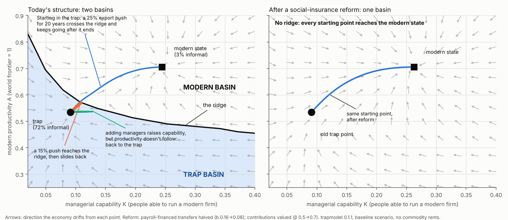
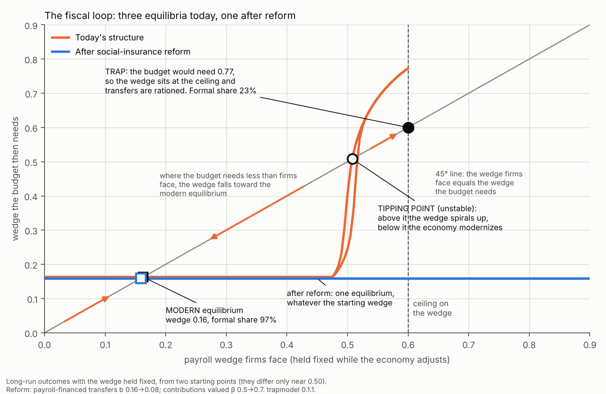
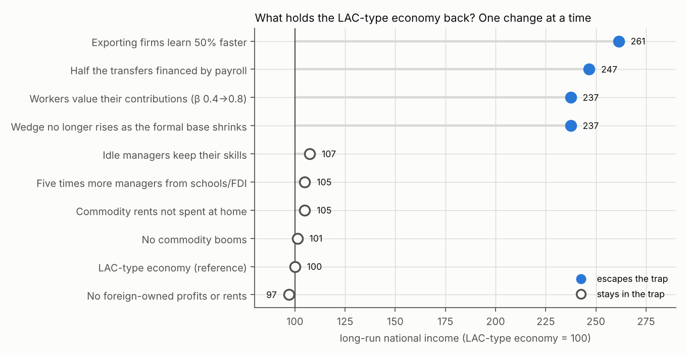
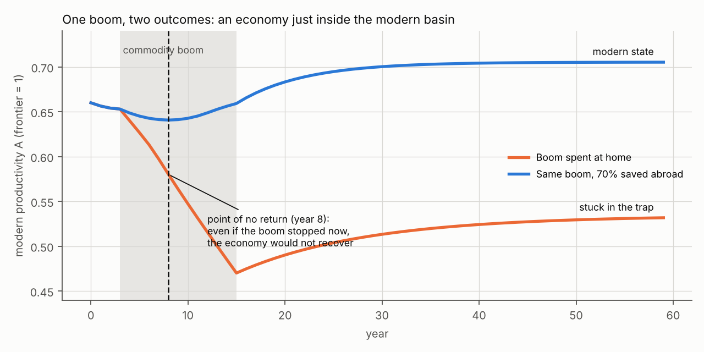
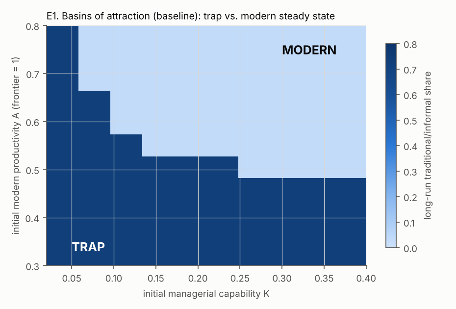
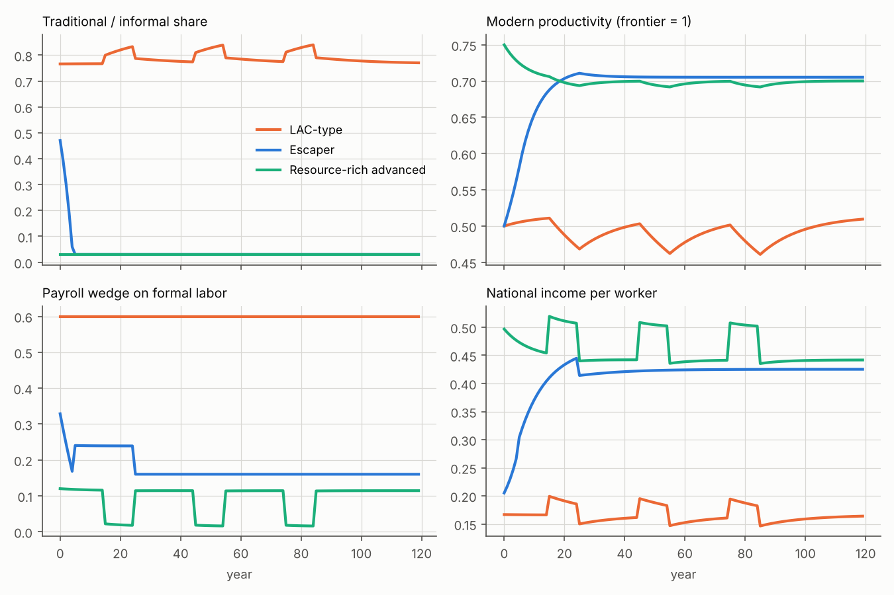
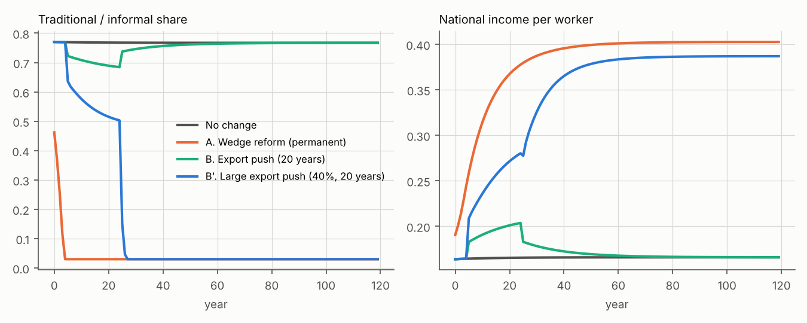
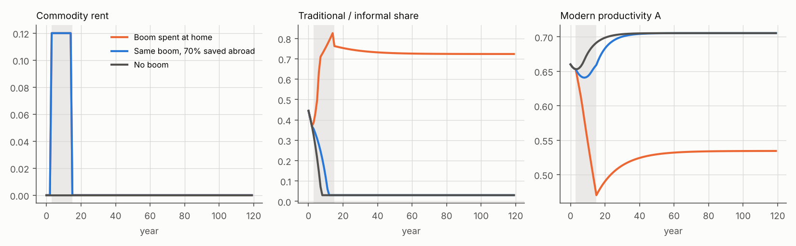

# A Segment Trap: A Minimal Model of Why Middle-Income Economies Get Stuck

**devtheory Working Paper 04** · Draft v0.2 · 3 November 2026 · Model: [`trapmodel` 0.1.1](../../model/README.md) · [Interactive explorer](../../model/explorer/index.html)
Project: Productive Development in Latin America and the Caribbean ([repository README](../../README.md))

---

## Abstract

This paper builds a small, deliberately transparent model of a middle-income trap. In the model the trap is a matter of an economy's *segment* composition (modern firms versus traditional and informal work), not its sector mix. The model brings together, in one dynamic general-equilibrium framework, the mechanisms discussed in WP01–WP03 and strand 9:
- managers come from experience in modern jobs (the capability loop);
- productivity catches up faster when firms sell in world markets (the learning loop);
- transfers and public goods are financed by a wedge on formal labor, which rises when the formal base is small (the fiscal loop);
- commodity rents spent at home raise the price of non-tradables (Dutch disease);
- foreign-owned profits and rents leave the country.

With illustrative parameters, the model has two steady states. A trap has about 72–77% of workers in traditional work, productivity at about half the frontier and the wedge at its ceiling; a modern state has 3% traditional work and about 2.5 times the national income. The trap matches Latin America's 70% of workers who are self-employed or in firms under 10, and its relative TFP of about 0.52. Starting from the same position, a "LAC-type" economy stays in the trap and an "escaper" leaves it within a decade. Four results stand out.
1. The fiscal loop is what keeps the trap in place. It drives the payroll wedge into the range where a trap exists and holds it there. With the wedge fixed at a high enough level, the capability and learning loops alone also produce two outcomes, but only in a narrow band. A permanent reform of how social insurance is financed is sufficient to escape. Temporary export pushes and manager injections work only if they are large enough to cross the threshold.
2. Faster learning in tradable firms is also sufficient, which points to competition and within-firm productivity growth.
3. Commodity booms and foreign ownership do not cause the trap, but a boom spent at home can tip an economy that is near the threshold into it permanently. Saving the same boom abroad avoids this.
4. Two hypotheses from the project's framework fail in this version: that a wedge reform needs an export engine to work, and that profit remittances deepen the trap.

The model is built to be tuned. Every parameter sits in an editable scenario file, every mechanism can be switched off, accounting identities are tested, and every number below is regenerated by one script.

---

## The main conclusions in four pictures

All four figures are generated by [`model/visuals.py`](../../model/visuals.py). The [interactive explorer](../../model/explorer/index.html) lets you move the settings and watch the basins change.

**1. The landscape: a trap basin, a modern basin, and the ridge between them.** Policies are moves on this map. A 15% export push reaches the ridge and slides back. A 25% push crosses it, and the economy keeps modernizing after the push ends. Adding managers without raising productivity goes nowhere. Reforming how social insurance is financed removes the ridge altogether.

**2. Why the trap exists: the fiscal loop as two crossing curves.** The hiring curve shows the wedge at which firms settle at each formal share; the budget curve shows the wedge the budget needs at that share. Where they cross there are three equilibria. In the trap, the budget needs more than the ceiling allows, so the wedge sits at the ceiling and transfers are rationed. The modern state has a low wedge. Between them lies an unstable tipping point. After the reform, the curves cross only once.

**3. What holds the economy back: one change at a time.** Four changes escape: three that weaken the fiscal loop and one that speeds up learning in exporting firms. Commodity booms, foreign ownership and managers from outside move national income by a few percent at most.

**4. Commodity booms: a ratchet near the threshold.** The same boom, spent at home or saved abroad, sends an economy near the ridge to opposite fates. Eight years into the boom, stopping it would no longer bring the economy back.

---

## 1. Why a model, and why this one

The project's framework (`docs/theory/01_framework.md`, Idea 4) claims that Latin America's low-productivity state is held in place by interlocking loops. Claims about interacting feedbacks are where verbal reasoning is least reliable. A model is the cheapest way to check three things: whether the loops really produce a trap, which loops matter, and what it takes to escape.

The closest formal benchmark is Agénor & Canuto (2015), a model with occupational choice, talent misallocation and multiple steady states (strand 9, L111). This model differs in three ways that follow from the project's earlier work:
1. **The trap is about segments.** Its low state is a large traditional/informal segment, not a lack of designers or R&D (framework Idea 1; WP02).
2. **The fiscal side is explicit.** Social insurance and transfers are financed by a wedge on formal labor (Levy, L033; WP02).
3. **The open-economy side is explicit.** Commodity rents, foreign ownership and the real exchange rate are built in (WP01, WP03).

---

## 2. The model

A small open economy has a labor force of 1. All values are in units of the tradable good, whose world price is 1; non-tradable services have price $P$. Full equations and code are in [`model/`](../../model/README.md).

### 2.1 Who works where

There are three segments:
- **Modern tradable firms** employ $x$ workers and sell at the world price.
- **Modern non-tradable firms** employ $n$ workers and sell services at home at price $P$.
- **Traditional/informal self-employment** employs $u = 1 - x - n$ and produces services with productivity $a_T$.

Informal workers also receive a transfer $b$ per person, indexed to non-resource GDP per capita:

$$y_T = P a_T + b\,Y^{nr}.$$

Formal jobs carry a payroll wedge $\tau$, of which workers value a fraction $\beta$. A worker takes a formal job if

$$W\,[1 - (1-\beta)\tau] \ge y_T ,$$

so the formal labor cost $W$ rises with informal income, with the wedge, and with how little workers value their contributions. This is the Levy mechanism (WP02 §5).

### 2.2 Firms need managers

Modern firms must be run by a manager. $K$ people have the capability to manage. Each chooses to run a tradable firm, a non-tradable firm, or nothing:
- A tradable firm produces $A\ell^\alpha$.
- A non-tradable firm produces $\nu A\ell^\alpha$ units of services, worth $P\nu A\ell^\alpha$.
- $A$ is modern productivity relative to the world frontier, and $\alpha < 1$ captures the limits of one manager's span of control.

Firms hire until the marginal product equals $W$. Profits are $(1/\alpha - 1)W\ell$. Managers choose between tradable and non-tradable firms by comparing profits (a logit with sharpness $\eta_{alloc}$). They run a firm only if profits beat an outside option $\kappa_m y_T$ (a logit with sharpness $\eta_{part}$), so $q$ is the share of capable managers who actually run firms.

### 2.3 Government

The state finances public goods $g\,Y^{nr}$ and transfers $b\,Y^{nr}u$ (plus any export subsidy) with the payroll wedge on formal labor and a share of commodity rents:

$$\tau\,W(x+n) + \kappa_R\,\theta_R R^{ret} = g\,Y^{nr} + b\,Y^{nr}\,u + \text{subsidy}, \qquad 0 \le \tau \le \tau_{max}.$$

This is the **fiscal loop**. When the formal base $W(x+n)$ is small and the informal population $u$ is large, the wedge needed is high, which keeps the formal base small. If the wedge hits its ceiling, transfers are rationed. $\kappa_R$ sets how much of the state's rent revenue lowers the wedge. The rest funds extra spending, a rough proxy for Latin America's procyclical fiscal policy.

### 2.4 Open economy

- **Commodity rent** $R$ comes from an enclave sector with no workers.
- **Foreign ownership.** Foreigners own a share $\rho_R$ of rents and $\rho_F$ of modern profits; these leave the country (GNI < GDP).
- **Saving abroad.** A share $1-\sigma_R$ of retained rents is saved abroad, as in a sovereign fund.

Domestic absorption $Z$ is GNI minus savings abroad. Households and the state spend a share $1-\psi$ of $Z$ on non-tradable services, which clears that market:

$$(1-\psi)\,Z = P\,(Y_N + Y_T).$$

Rents spent at home raise $P$, which raises informal income, hence $W$, hence costs for tradable firms. That is **Dutch disease**. Trade balances every period.

### 2.5 Dynamics

$$K' = K(1-\delta_K) + \lambda_X x + \lambda_N n + k_0 - \delta_{idle}(1-q)K$$

$$A' = A + (\theta_X x + \theta_N n)(1 - A) - g^* A$$

- **Capability loop.** Modern jobs, especially tradable ones ($\lambda_X > \lambda_N$), turn workers into future managers (Bobba et al. L102; Franco & Quintero L103; proposition P6).
- **Learning loop.** Tradable employment pulls productivity toward the frontier faster than non-tradable employment ($\theta_X > \theta_N$; Atkin, Costinot & Fukui L053). Without it, relative productivity erodes at $g^*$ as the frontier moves.
- **Ratchet.** Capable people who are not running firms lose capability faster ($\delta_{idle}$).

### 2.6 Parameters and status

All parameters are listed in [`model/calibration.md`](../../model/calibration.md) with evidence and status. Two outcomes of the baseline are loosely anchored:
- the trap-state traditional share (≈ 0.72–0.77), against about 70% of Latin American workers self-employed or in firms under 10 (L040; segment definition D-005);
- the trap-state productivity (≈ 0.51), against LA5 TFP of about 0.52 of the US (L041).

Everything else is illustrative.

---

## 3. Results

### E1. Two steady states, and a basin boundary that depends on both capability and productivity

*Figure 1. Long-run traditional share by starting managerial capability (K) and productivity (A), baseline parameters. Generated by `model/experiments.py` (E1).*

About half the grid of starting points ends in the trap (u ≈ 0.72); the rest reaches the modern state (u ≈ 0.03). The boundary slopes down. At productivity of 0.7 of the frontier, a small stock of managers is enough to escape; at 0.5 a very large stock is needed; at 0.3 nothing escapes. **Capability and productivity are complements.** Building managers without raising productivity, or the reverse, does not escape the trap. Section E4 shows this directly.

### E2. Same start, different structure: stuck versus escaping

*Figure 2. Three scenarios (`lac_type`, `escaper`, `resource_rich_advanced`). E2 in `experiments.py`.*

The LAC-type and escaper scenarios start from the same capability and productivity (K = 0.10, A = 0.50). They differ only in:
- the size of payroll-financed transfers;
- how much workers value contributions;
- commodity rents and foreign ownership (LAC-type only);
- a 15% export subsidy for 20 years (escaper only).

The LAC-type stays in the trap: long-run traditional share 0.77, productivity 0.51, wedge at its ceiling, and recurring commodity booms that each leave productivity slightly lower. The escaper modernizes within about five years and ends with **2.6 times** the national income. The resource-rich advanced economy starts in the modern basin. It taxes its rents, saves most of them abroad and uses part to lower the wedge, so it rides through three booms without leaving the modern state.

### E3. Which mechanisms hold the LAC-type back?

Each change below is made alone, from the start of the LAC-type scenario.

| Change (one at a time, from t = 0) | Long-run informal share | Productivity A | Wedge | National income (LAC-type = 100) |
|---|---:|---:|---:|---:|
| LAC-type (reference) | 0.77 | 0.51 | 0.60 | 100 |
| fiscal loop off (wedge fixed at 0.25) | 0.03 | 0.72 | 0.25 | 237 |
| rent absorption off (rents not spent) | 0.75 | 0.53 | 0.60 | 105 |
| remittances off (all profits national) | 0.81 | 0.46 | 0.60 | 97 |
| ratchet off (no extra idle-manager loss) | 0.75 | 0.52 | 0.60 | 107 |
| smaller payroll-financed transfers (b 0.16→0.08) | 0.03 | 0.72 | 0.16 | 247 |
| contributions valued (beta 0.4→0.8) | 0.03 | 0.72 | 0.16 | 237 |
| no commodity cycles | 0.75 | 0.53 | 0.60 | 101 |
| faster learning in tradables (theta_X ×1.5) | 0.03 | 0.79 | 0.16 | 261 |
| more managers from outside (k0 ×5) | 0.76 | 0.51 | 0.60 | 105 |

*Table 1. Source: `tables/E3_attribution.md`.*

The mechanisms fall into three groups.
- **Trap-sustaining: the fiscal loop.** Removing it, halving payroll-financed transfers, or making contributions valued (linking benefits to contributions) each lets the economy escape on its own. (Section 4.1 explains why "sustaining" is more accurate than "creating".)
- **Trap-breaking from the productivity side: faster learning in tradables.** A 50% faster catch-up in tradable firms escapes on its own and gives the highest income. In the real world this parameter stands for competitive pressure, technology adoption and management upgrading inside firms. Those are the within-firm channels the IMF identifies as Latin America's main TFP problem (L041).
- **Aggravating but not trap-creating.** Commodity booms, the ratchet and outside supplies of managers move outcomes by a few percent but do not change which basin the LAC-type economy ends in.

One result runs against intuition. Switching remittances *off* makes the LAC-type slightly worse off (national income 97). Profit outflows reduce domestic absorption, which keeps the real exchange rate weaker and helps tradable firms. In this version, the foreign-exchange cost of foreign ownership that WP03 emphasizes is offset by this "transfer effect". WP03's concern is about external constraints that bind through crises, which v0.1 does not model (§5).

### E4. Escaping from inside the trap

Starting from the LAC-type trap state (K = 0.081, A = 0.51), with commodity cycles switched off:

| Package (starting inside the LAC-type trap) | Long-run informal share | Productivity A | National income (no change = 100) |
|---|---:|---:|---:|
| No change | 0.77 | 0.52 | 100 |
| A. Wedge reform (permanent) | 0.03 | 0.72 | 243 |
| B. Export push (20 years) | 0.77 | 0.52 | 100 |
| B'. Large export push (40%, 20 years) | 0.03 | 0.72 | 233 |
| C. Manager/FDI injection (15 years) | 0.77 | 0.52 | 100 |
| A + B | 0.03 | 0.72 | 243 |
| A + C | 0.03 | 0.72 | 243 |
| B + C | 0.77 | 0.52 | 100 |

*Table 2. Wedge reform: transfers financed by payroll halved (b 0.16 → 0.08) and contributions valued (β 0.4 → 0.7). Source: `tables/E4_policy.md`.*

*Figure 3. Selected packages. E4 in `experiments.py`.*

1. **Temporary policies work only if they cross the threshold.** A 15% export subsidy for 20 years reduces informality while it lasts (from 0.77 to about 0.68), then everything returns to the trap. A 40% subsidy for the same period crosses the threshold, and the economy stays modern after the subsidy ends. This is the classic big-push logic of multiple equilibria: a temporary policy either tips the economy or leaves no trace.
2. **Manager injections alone fail** because productivity, not managers, binds in the trap (see E1).
3. **The permanent wedge reform works alone and fastest.**
4. **Pushes have a fiscal cost that falls on the poor in this model.** With the wedge at its ceiling, the large export push is paid for by rationing transfers to informal workers: they fall to zero at the start of the push. In practice a big push needs its own financing.

### E5. The commodity ratchet is real but conditional

*Figure 4. One 12-year boom hitting an economy just inside the modern basin (K = 0.08, A = 0.66). The spent and saved cases share the same rent path, so the left panel shows one line. Shaded: boom years. E5 in `experiments.py`.*

The boom is spent at home with no wedge relief ($\sigma_R = 1$, $\kappa_R = 0$). It raises the price of non-tradables and the cost of formal labor, so tradable employment, learning and productivity collapse. When the boom ends, the economy is inside the trap's basin and stays there: long-run traditional share 0.72, and national income **44%** of the no-boom path.

The same boom with 70% saved abroad leaves only a small dip, and the economy modernizes. Section 4.3 explains why the ratchet depends on the starting point.

---

## 4. What holds middle-income economies back? (Answers from v0.1)

### 4.1 The main mechanism: a fiscal-segment loop

A social contract that finances transfers to informal workers and public goods through a wedge on formal jobs creates a self-reinforcing trap. A large informal sector needs a high wedge; a high wedge keeps the formal sector small. This is the model counterpart of Levy's diagnosis for Mexico (L033) and of the fiscal loop in WP02.

Figure 2 shows how the loop works. With the wedge held fixed, every starting point modernizes at wedges up to about 0.475, and every start ends in the trap at 0.525 or more. Only in a narrow band around 0.50 does the outcome depend on the starting point, through the capability and learning loops alone. The fiscal loop makes the trap robust: a shrinking formal base raises the wedge the budget needs, which pushes the economy into the high-wedge region and keeps it there.

### 4.2 The main escape route besides fiscal reform: learning in tradable firms

Faster productivity growth inside exporting firms escapes the trap on its own. This connects the model to the evidence that Latin America's TFP problem lies within surviving firms (L041), and to competition and management as the levers (L038, L040, L046, L047).

### 4.3 Capability and productivity are complements

The basin boundary depends on both. Supplying managers (education, FDI managers) without productivity growth, or productivity without managers, does not escape. This formalizes why single-instrument strategies disappointed (Kehoe & Ruhl, L063). It is also the economic counterpart of the complementarities in Schneider's hierarchical capitalism (L110).

### 4.4 Commodity booms and foreign ownership are amplifiers, not causes

They matter near the threshold. A boom spent at home can push a country that was on its way out back into the trap for good. This is the conditional, testable version of the commodity–capability ratchet (framework Idea 4, loop 3; proposition P7). It suggests why resource-rich Latin American economies in the 1970s and 2000s fared differently from resource-rich advanced economies that saved and taxed their rents.

### 4.5 Two hypotheses that failed in v0.1, and why that matters

1. **"Fiscal reform needs an export engine" (framework Idea 5)** fails here: a permanent wedge reform escapes alone. The reason is that v0.1's absorption constraint is weak. Demand for modern services grows smoothly with income, and the formal economy's expansion creates its own demand. Whether the constraint binds in reality is an empirical question (P10). Making it bind in the model requires either low income elasticities for services or a binding external constraint.
2. **"Profit remittances deepen the trap" (WP03)** fails here because of the transfer effect on the real exchange rate. WP03's concern is the claim on scarce foreign exchange, which matters when external financing can stop suddenly. v0.1, with trade balanced every period, cannot see that.

---

## 5. Limitations, and what to tune next

The model is a first version. Its main limitations, in order of importance:

1. **Multiplicity is robust only with the fiscal loop.** Draft v0.1 of this paper said that switching off the fiscal loop leaves a single steady state. That holds only at a low fixed wedge (0.25, the value tested). With the wedge fixed near 0.50, the capability and learning loops alone produce two steady states, but in a narrow band (Figure 2, `tables/V2_wedge.csv`). Whether stronger increasing returns in the capability loop, such as manager spillovers or minimum efficient scale, would widen that band remains the most important open question for v0.2 (OQ-22).
2. **No external constraint with crises.** Trade balances every period, so the balance-of-payments mechanisms of WP01 and WP03 (Thirlwall's law, sudden stops, foreign-exchange claims of domestic-market FDI) appear only through the real exchange rate.
3. **Fast transitions.** The static equilibrium adjusts instantly, so escapes take years rather than decades. Adjustment costs for firms and labor would slow them.
4. **Illustrative calibration.** Only two outcomes are loosely anchored. The wedge in the trap (0.60, at its ceiling) is too high relative to statutory payroll burdens. It should be read as the whole fiscal burden on formal salaried work, and it needs estimation.
5. **No competition block.** The incumbent–competition loop of Idea 4 enters only implicitly through $\theta_X$.

**Tuning roadmap (v0.2 candidates, logged as OQ-22 to OQ-26):**
- an independent source of increasing returns in the capability loop (manager spillovers);
- a demand block with low income elasticities for modern services, to test Idea 5;
- an external-finance block with sudden stops;
- markups and entry, to make competition explicit;
- calibration of β, b, λ and θ to Mexico, Brazil, Chile and Colombia, using the sources in `model/calibration.md`.

---

## 6. Propositions derived from the model (added to the project list)

- **P21.** Within countries over time, larger payroll-financed non-contributory transfers (relative to average income) raise the informal share more where the formal base is already small (nonlinearity from the fiscal loop).
- **P22.** Episodes of formal-sector take-off are preceded by changes in the formality wedge or by large, sustained export expansions, not by small or temporary ones (threshold effects).
- **P23.** Commodity booms produce lasting declines in tradable employment and productivity only in economies near the modern/traditional threshold. The effect is weaker where rents are saved or used to lower taxes on formal labor (conditional ratchet; refines P7).
- **P24.** Increases in managerial supply (education, FDI managers) raise formal employment persistently only where productivity in tradable firms is also rising (complementarity of K and A).

---

## References

Model-specific references; for the rest see `references/literature_register.csv`.

- Agénor, P.-R. & Canuto, O. (2015). Middle-income growth traps. *Research in Economics*, 69(4), 641–660. (L111)
- Atkin, D., Costinot, A. & Fukui, M. (2021). Globalization and the ladder of development. NBER WP 29500. (L053)
- Bobba, M., Flabbi, L., Levy, S. & Tejada, M. (2021). Labor market search, informality, and on-the-job human capital accumulation. *Journal of Econometrics*, 223(2). (L102)
- Franco, S. & Quintero, J. M. (2025). (In)formal growth: knowledge dynamics with learning segmentation. Working paper. (L103)
- IMF (2025). *Regional Economic Outlook: Western Hemisphere*, October. (L041)
- Kaminsky, G., Reinhart, C. & Végh, C. (2004). When it rains, it pours: procyclical capital flows and macroeconomic policies. *NBER Macroeconomics Annual*, 19. (L113)
- Levy, S. (2018). *Under-Rewarded Efforts*. IDB. (L033)
- Lucas, R. E. (1978). On the size distribution of business firms. *Bell Journal of Economics*, 9(2). (L114)
- Schneider, B. R. (2013). *Hierarchical Capitalism in Latin America*. Cambridge UP. (L110)
- World Bank (2024). *Competition: The Missing Ingredient for Growth?* (L040)
