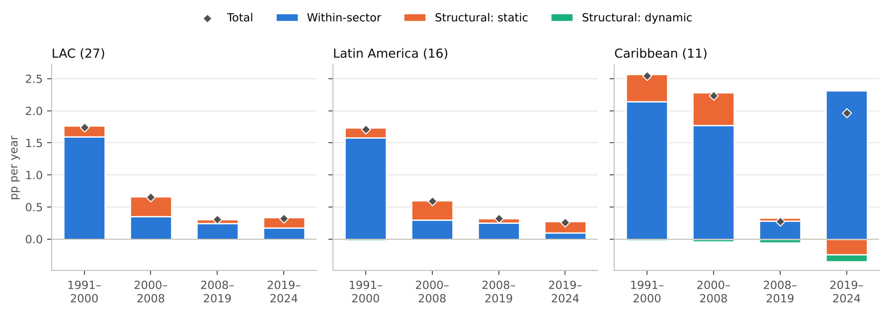
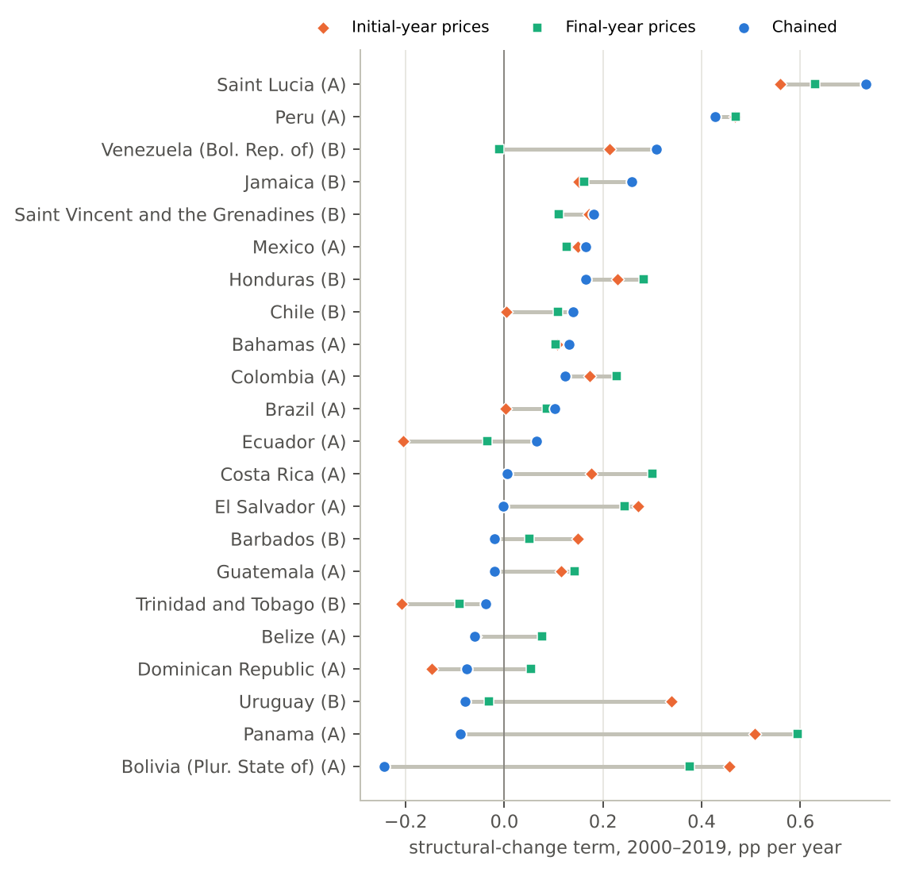
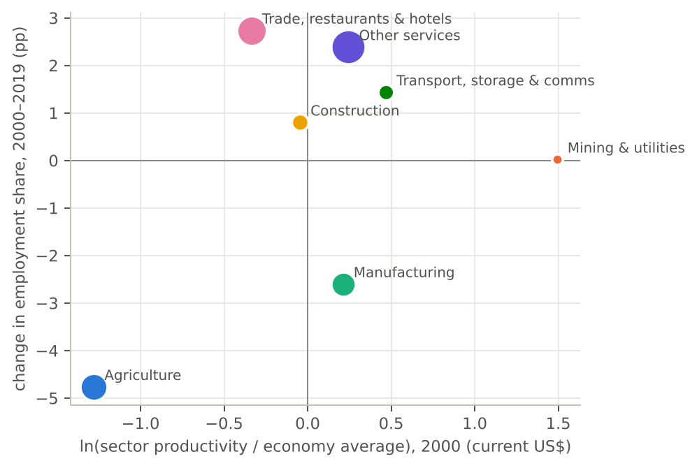

# WP06 — Structural Change and Labour Productivity in Latin America and the Caribbean, 1991–2024

*Paul Wander. Draft v0.1, 2026-11-09. Companion to [WP05](../WP05_caribbean_structural_change/WP05_caribbean_structural_change.md) (Caribbean).*

**Code:** [`empirics/code/carib_lp/`](../../empirics/code/carib_lp/README.md) (`LP_SCOPE=lac`) · **Generated outputs:** [coverage](../../empirics/output/lac_lp/coverage.md), [validation](../../empirics/output/lac_lp/validation/validation.md), [country results](../../empirics/output/lac_lp/results.md), [regional summary](../../empirics/output/lac_lp/summary/summary.md) · **Dashboard:** [`empirics/dashboard/`](../../empirics/dashboard/README.md) · **Decisions:** D-030 to D-035

## Summary

This paper decomposes labour-productivity growth in 29 Latin American and Caribbean economies since 1991. It separates growth within sectors from growth due to workers moving between sectors. It extends WP05's Caribbean panel to the 33 member States of ECLAC in the region. The main findings, each qualified in the text:

1. **The region's productivity problem is within sectors.** In the pooled region (27 economies), within-sector growth fell from 1.6–2.0% a year in 1991–2000 to 0.24–0.31% in 2008–19. Total labour-productivity growth fell from 1.7–1.9% to 0.30–0.35%.
2. **Structural change has not been growth-reducing in the aggregate since 2000.** The pooled structural-change term is positive under all three price treatments: 0.30–0.32 pp a year in 2000–08 and 0.14–0.17 pp in 2000–19. That is roughly a quarter to a third of the region's meagre growth. For the 1990s its sign depends on the price base (−0.04 to +0.14 pp), so this paper neither confirms nor refutes the finding of growth-reducing structural change in Latin America after 1990.
3. **Reallocation gives static gains and small dynamic losses.** Workers left agriculture and manufacturing for trade, transport and other services. The sectors that received them had above-average productivity, but their relative productivity fell as they grew. In 70% of well-anchored countries (2000–19) the static term is positive and the dynamic term negative.
4. **Single-country structural terms are fragile.** For a fifth of well-anchored country-periods (20 of 109), the sign of the structural term depends on how sectors are valued (D-035). Only 58 of the 109 are clearly positive or clearly negative under all three treatments.
5. **The region's average is shaped by Mexico and Brazil.** They account for about two-thirds of pooled value added. Mexico's productivity per worker fell over 2000–19 despite robustly positive structural change. The typical country did considerably better than the pooled region: median growth 1.40% a year in 2000–19, against 0.45–0.61% pooled.
6. **The Caribbean stalled after 2008.** Excluding Guyana and the Dominican Republic, Caribbean productivity per worker fell by 1.4–1.5% a year over 2008–19. The Caribbean's strong 2019–24 figure is Guyana's oil.

## 1. Purpose and relation to WP05

WP05 built a sectoral labour-productivity panel for the Caribbean, because the standard source, the GGDC/UNU-WIDER Economic Transformation Database (ETD), covers no Caribbean country (L115). This paper applies the same pipeline to the whole region, so that Latin America and the Caribbean are measured in one consistent way. The ETD covers nine Latin American countries. Checking this paper's results against it is the most important pending test (OQ-44).

The question is the one McMillan and Rodrik (2011) put to the region: did productivity growth come from sectors becoming more productive, or from workers moving to more productive sectors? Their answer for Latin America after 1990 was that reallocation *reduced* growth: workers moved from higher- to lower-productivity activities (L018). Diao, McMillan and Rodrik (2017) found that the region's later growth came from within-sector gains, with reallocation contributing little or negatively (L019). The framework of this project (Idea 1, P1–P2) argues that the relevant reallocation in LAC is between segments, formal and informal and by firm size, not between sectors. This paper cannot test that directly, because it works with sectors. It does establish the sector-level facts that the segment argument has to explain.

## 2. Data and method

The method is WP05's (§2 there), with the changes below.

**Countries (D-030).** The 33 Latin American and Caribbean member States of ECLAC. Sector employment is available for 29. ILO publishes no sector employment estimates for Antigua and Barbuda, Dominica, Grenada or Saint Kitts and Nevis, and their surveys are too sparse to use.

**Sources.** UN National Accounts Main Aggregates (value added by seven sectors, constant 2020 and current US dollars, January 2026 upload) and ILOSTAT employment by economic activity (ILO modelled estimates and national surveys). All are committed in `empirics/data/source/` (D-029).

**Sectors.** Grid A has seven sectors: agriculture; mining and utilities; manufacturing; construction; trade, restaurants and hotels; transport, storage and communication; other services. Grid B has five, with all services combined. Grid A is used throughout the text. Grid B results are in the generated tables and do not change any conclusion.

**Employment and anchoring.** Employment comes from the ILO modelled estimates. Each country-period is graded by whether both endpoints are within two years of a usable survey year (A), one is (B), or neither is (C). Only A and B are interpreted. Grade-A coverage improves steadily over time: in grid A, 7 of 29 countries for 1991–2000, 13 for 2000–08, 18 for 2008–19 and 21 for 2019–24.

**Validation.** Between pairs of survey years, decompositions using modelled employment reproduce those using survey employment well: 114 pairs in 26 countries, correlation of the structural term 0.90, median absolute gap 0.13 pp a year, same sign in 92% of cases (grid A).

**National coverage rule (D-031).** A survey year is used only if its total employment is at least 80% of ILO's national estimate. Urban-only surveys understate agriculture and so bias sector shares. The rule excludes all of Argentina's survey years (its survey covers urban areas only), Uruguay 2000–05, eight Bolivian years, three Ecuadorian years (1999–2002), and one or two years each for Panama, Peru and Suriname. Argentina is therefore graded C throughout. Its decompositions rest on ILO's model alone and are not interpreted.

**Price base (D-024, D-032, D-035).** Adding sectors together requires valuing them at common prices. Three treatments are computed:
- *initial-year* prices of each period (the default);
- *final-year* prices;
- *chained*: one decomposition per year at previous-year prices, averaged.

Each has a known failure. Fixed bases mis-weight sectors whose relative price moves a lot over the period. For example, Uruguay's productivity growth over 2000–19 is 3.5% a year at 2000 prices against 1.4% from the official total, because the volume of transport, storage and communications (which includes telecoms) rose 7.5-fold while its relative price fell. Chaining turns year-to-year sampling noise in employment shares into reallocation that never happened. A result is treated as robust only if all three agree.

**Pooling.** Regional results treat a group of countries as one economy with seven sectors. Sector value added is summed in current US dollars and moved forward with each country's own volume index; employment is summed. Cuba and Venezuela are excluded from pooled groups, because their US-dollar levels are not comparable (D-033). Shifts of workers *between countries* within a sector count as within-sector change. Pooled results are dominated by the largest economies, so they are reported next to the distribution across countries.

**Static and dynamic parts.** The structural term splits into a static part (reallocation at initial productivity levels) and a dynamic part (whether the sectors gaining workers also raised their productivity) (L118). In chained form the dynamic part is close to zero by construction. The split is therefore read at initial-year prices.

## 3. Results

### 3.1 The region: slowing growth, mostly within sectors



*Figure 1. Pooled labour-productivity growth and its components, by period (grid A, chained prices; ILO modelled employment). Number of economies in brackets. Ranges across price bases are given in the text.*

For the pooled region, labour-productivity growth fell from 1.7–1.9% a year in 1991–2000 to 0.65–0.93% in 2000–08. It fell again to 0.30–0.35% in 2008–19 and stayed at 0.25–0.39% in 2019–24. The decline is almost entirely in the within-sector term, from 1.6–1.95 pp a year in the 1990s to 0.24–0.31 pp in 2008–19.

Over 2000–08, which includes the 2001–02 crises as well as the commodity boom, growth came from more jobs rather than more output per worker: pooled employment grew 2.5% a year, against 0.65–0.93% for productivity per worker. In the 1990s the two had grown at similar rates (employment 2.2%, productivity 1.7–1.9%).

The pooled figures are dominated by the two largest economies. In 2000, Mexico accounted for 37% of pooled value added and Brazil for 29% (by 2019, 27% and 35%). Mexico's productivity per worker fell in 2000–08 (−0.20% to −0.24% a year) and over 2000–19 as a whole (−0.29% to −0.34%, close to the −0.35% implied by its official chain-linked total). That is why the pooled region looks worse than the typical country. Median productivity growth across well-anchored countries was 1.15% a year in 1991–2000, 1.80% in 2000–08, 0.64% in 2008–19 and 0.64% in 2019–24. The share of countries with *falling* productivity rose from none in the 1990s to 29% in 2008–19 and 35% in 2019–24.

The two views agree on the main point. Productivity growth after 2008 was weak almost everywhere, and the weakness was within sectors. This matches the IMF's finding that weak productivity in the five largest Latin American economies is concentrated within surviving firms rather than in reallocation (L041). It also matches Diao, McMillan and Rodrik's finding that within-sector gains drove the region's earlier growth (L019).

### 3.2 Structural change: positive in the aggregate since 2000, ambiguous in the 1990s

The pooled structural-change term is positive and stable across price bases after 2000:

| Period | Structural term, pp/yr (range across price bases) | Share of growth |
|---|---|---|
| 1991–2000 | −0.04 to +0.14 | −2% to 8% |
| 2000–2008 | +0.30 to +0.32 | 34% to 46% |
| 2008–2019 | +0.03 to +0.07 | 9% to 21% |
| 2019–2024 | +0.15 to +0.20 | 46% to 61% |
| 2000–2019 | +0.14 to +0.17 | 23% to 36% |

Two readings follow.

First, **structural change was not the region's problem after 2000.** Reallocation added a modest amount to growth in every period. Its share of growth rose in 2000–08 and 2019–24, but mainly because within-sector growth fell, not because reallocation strengthened.

Second, **the 1990s are not settled by these data.** At 1991 prices the pooled structural term is slightly negative (−0.04 pp), which is the sign McMillan and Rodrik reported for 1990–2005. At chained or 2000 prices it is positive (+0.14 pp). Three limitations stop this paper from going further:
- employment in the 1990s rests on ILO's model, with only 7 of 29 countries grade A;
- seven sectors are coarser than the nine or ten in the data McMillan and Rodrik used;
- the periods differ.

The country distribution points the same way. In 1991–2000 the median structural term was +0.08 pp, but it was negative in 44% of well-anchored countries. Growth-reducing reallocation was common in the 1990s, though not dominant.

### 3.3 Countries: which results survive the price base



*Figure 2. Structural-change term, 2000–2019, at three price bases (grid A; grades A and B; Guyana omitted for scale, see text).*

Across all periods, 109 country-periods are grades A or B in grid A. Their structural terms fall into five groups:

| Verdict | Number |
|---|---|
| Positive at all three price bases (≥ 0.1 pp) | 40 |
| Negative at all three (≤ −0.1 pp) | 18 |
| Near zero at all three | 13 |
| Same sign, size differs | 18 |
| Sign depends on the price base | 20 |

For 2000–19 (Figure 2), the results are:
- **Robustly positive:** Peru (0.43–0.47 pp a year, roughly a quarter of its growth), Saint Lucia, Jamaica, Saint Vincent and the Grenadines, Mexico, Honduras, Colombia and the Bahamas.
- **Robustly negative:** Guyana, where shifts around agriculture before 2019 and oil after it make the structural term almost entirely dynamic (OQ-38).
- **Sign depends on the price base:** Bolivia, Panama, Uruguay, the Dominican Republic, Guatemala, El Salvador, Ecuador, Barbados and Venezuela. Statements about the direction of structural change in these countries, in either direction, are not supported by these data.

Mexico illustrates why the structural term cannot be read on its own. Reallocation added 0.13–0.17 pp a year over 2000–19 under every treatment, yet productivity per worker fell, because within-sector productivity fell by 0.45–0.47% a year. Mexico's problem is not where its workers went. It is what happened inside the sectors where they work.

The fragility has two sources, and they point in different directions. Fixed bases fail where relative prices move a lot: Uruguay's telecoms, and the oil and minerals of Guyana, Trinidad and Tobago and Suriname. Chaining fails where annual employment shares are noisy, which is where ILO's estimates follow annual surveys. Bolivia's agriculture share, for instance, moves 36.6 → 41.8 → 39.7 → 32.7% in 2000–03. Smoothing employment shares before chaining fixes some cases and breaks others (D-035), so neither failure can be engineered away with these data. A finer sector grid and longer survey-based series would reduce both.

### 3.4 Where workers went: static gains, eroding gains



*Figure 3. Change in employment share, 2000–2019, against relative productivity in 2000 (pooled LAC, 27 economies, current US$). Bubble size: employment share in 2000.*

Employment shares in the pooled region moved as follows:

| Sector | 1991 | 2024 | Change, pp | Relative productivity 2000 | Relative productivity 2024 |
|---|---|---|---|---|---|
| Agriculture | 21.6% | 13.0% | −8.6 | 28 | 49 |
| Manufacturing | 15.9% | 12.0% | −3.9 | 124 | 135 |
| Trade, restaurants and hotels | 21.3% | 25.3% | +4.0 | 71 | 71 |
| Other services | 29.1% | 33.9% | +4.8 | 128 | 113 |
| Transport, storage and communication | 4.5% | 7.0% | +2.5 | 160 | 116 |
| Construction | 5.8% | 7.2% | +1.4 | 96 | 69 |
| Mining and utilities | 1.8% | 1.6% | −0.2 | 445 | 498 |

*Relative productivity: sector value added per worker as a share of the economy average (=100), current US$.*

The pattern has three parts.

- **The exit from agriculture is the main source of static gains.** Agriculture's productivity is far below average, so moving workers out raises the average. Agriculture's relative productivity also rose sharply as it shed workers. Part of that rise is relative prices, because the commodity boom raised food prices and the measure is in current dollars.
- **Workers did not go mainly to low-productivity activities.** Most went to other services and transport, whose productivity in 2000 was above average. That is why the static term is positive. Trade, restaurants and hotels, at about 70% of average productivity, absorbed nearly as many.
- **The sectors that absorbed workers lost relative productivity as they grew.** Other services fell from 128 to 113, transport from 160 to 116 and construction from 96 to 69. This is the dynamic term: in 70% of well-anchored countries over 2000–19 the static term is positive and the dynamic term negative (medians +0.19 and −0.11 pp a year at initial-year prices). De Vries, Timmer and de Vries (2015) reported the same pattern of "static gains, dynamic losses" for Africa (L118).

Manufacturing lost 3.9 points of employment share while staying above average productivity, and its relative productivity rose. Fewer workers in a more productive sector is the employment side of premature deindustrialisation. Its cost appears in the structural term: an above-average sector shrank.

One limit matters most for this project's framework. "Other services" bundles finance, business services, public administration, education, health and personal services. Its average productivity is above the economy's, but the jobs added in it could be in either its formal, larger-firm segment or its informal, own-account segment. Proposition P2 says post-1990 reallocation went mostly into the low-productivity segment of services. Sector data cannot test that, and Figure 3 is consistent with it: a sector whose average falls as it grows may be adding mostly below-average jobs. The test needs household-survey data by segment (P1, P2).

### 3.5 Latin America and the Caribbean compared

Latin America (16 economies) dominates the pooled region, so its results are close to the regional ones: structural term 0.13–0.16 pp a year over 2000–19, within-sector growth 0.27–0.46 pp.

The Caribbean (11 economies, excluding Cuba) looks different:
- **Faster before 2008.** Productivity grew 2.4–2.9% a year in the 1990s and 2.2–2.4% in 2000–08. Structural change contributed 0.40–0.51 pp, more than in Latin America.
- **Stalled after 2008.** Growth was 0.11–0.29% a year in 2008–19, with a structural term near zero. Without the Dominican Republic and Guyana, productivity per worker in the rest of the Caribbean fell by 1.4–1.5% a year (−1.36% to −1.53% across price bases).
- **Oil since 2019.** Pooled growth of 1.6–2.7% a year in 2019–24 is Guyana's oil. Without Guyana it is −0.08% to 0.36%, with a negative structural term (−0.15 to −0.20 pp).

The Caribbean's growth since 2008 has therefore come from two economies: the Dominican Republic's steady expansion, and Guyana's oil, which is an enclave in employment terms. The rest of the subregion has gone backwards.

## 4. What the evidence shows, what it does not, and what would change it

**What it shows.**
- Since 2000, the region's slow productivity growth has been a within-sector problem.
- Reallocation between sectors added modestly to growth in the aggregate.
- The sectors absorbing labour lost relative productivity as they grew.
- At the country level, the direction of structural change is often not identified by these data, and should be reported only where all three price treatments agree.

**What it does not show.**
- It cannot say *why* within-sector growth collapsed: misallocation across firms, informality, weak technology adoption or demand. It cannot say whether the jobs added in services were good or poor ones. Those questions need firm and household data (P1, P2, P9, P11).
- The 1990s sign of structural change is not identified (§3.2).
- Pooled results describe the region as one economy. They weight Mexico and Brazil heavily, and they treat moves between countries as within-sector change.
- Employment is ILO's model throughout. It is validated against surveys where both exist, but it is still a model, and for grade-C countries (including Argentina) nothing else is available.

**What would change the conclusions.**
- If the ETD (OQ-44), with its finer sectors and nationally sourced employment, showed a negative structural term for 2000–19 in the larger Latin American economies, finding 2 would fall.
- If survey-based segment decompositions showed that the services jobs added since 2000 were mostly informal and below-average in productivity, finding 3 would read differently: the positive static term would be a sector-level artefact hiding growth-reducing reallocation between segments. That would support P2.
- If national accounts revisions changed sector deflators for telecoms or mining, several country verdicts would move.

**Links to propositions.**
- **P2** (reallocation into the informal segment of services): not testable here. The sector facts are consistent with it but do not establish it.
- **P3** (no activity scores high on both absorption and dynamism): the sectors that absorbed most labour (other services, trade, transport, construction) are exactly those whose relative productivity fell or stayed low. That is suggestive, not a test.
- **P7** (commodity booms shift employment towards non-tradable services, with incomplete reversal): over 2000–08 manufacturing's employment share fell and construction, trade and transport rose. That is consistent with P7, but a boom-and-bust test needs country-level timing and the reversal.

## 5. Reproducing this paper

```
LP_SCOPE=lac python empirics/code/carib_lp/02_extract.py      # world source files -> LAC extracts
LP_SCOPE=lac python empirics/code/carib_lp/03_build_panel.py
LP_SCOPE=lac python empirics/code/carib_lp/03b_build_panel5.py
LP_SCOPE=lac python empirics/code/carib_lp/04_validate.py
LP_SCOPE=lac python empirics/code/carib_lp/05_decompose.py
LP_SCOPE=lac python empirics/code/carib_lp/07_lac_summary.py   # tables and figures in this paper
```

Every number in the text is in the generated files linked at the top. The dashboard shows the country results interactively, with the price-base toggle and the verdict for each country-period.

## References

Register IDs in brackets; status as recorded in `references/literature_register.csv`.

- Diao, X., McMillan, M. and Rodrik, D. (2017). *The Recent Growth Boom in Developing Economies: A Structural-Change Perspective.* NBER WP 23132. [L019]
- IMF (2025). *Regional Economic Outlook: Western Hemisphere*, October 2025. [L041]
- Kruse, H., Mensah, E., Sen, K. and de Vries, G. J. (2022). "A Manufacturing Renaissance? Industrialization Trends in the Developing World." *IMF Economic Review*. [L115]
- McMillan, M. and Rodrik, D. (2011). *Globalization, Structural Change and Productivity Growth.* NBER WP 17143. [L018]
- de Vries, G., Timmer, M. and de Vries, K. (2015). "Structural Transformation in Africa: Static Gains, Dynamic Losses." *Journal of Development Studies* 51(6). [L118, from memory]
- UN Statistics Division. National Accounts Main Aggregates Database, January 2026 upload. [L116]
- ILO. ILOSTAT, employment by sex and economic activity (modelled estimates and national sources), downloaded 2026-11-09. [L117]
